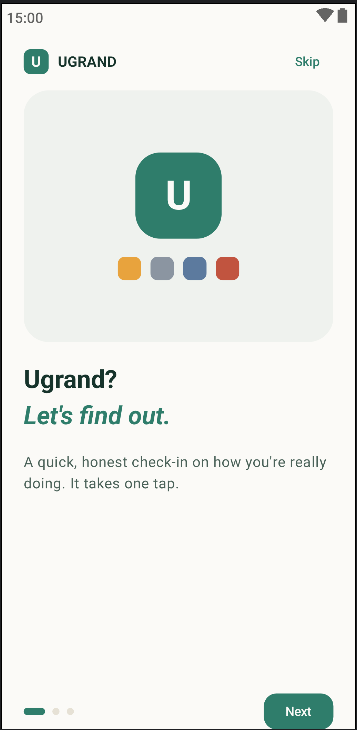
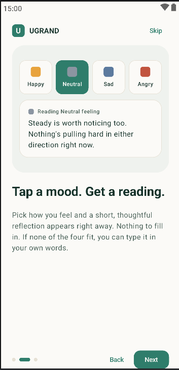
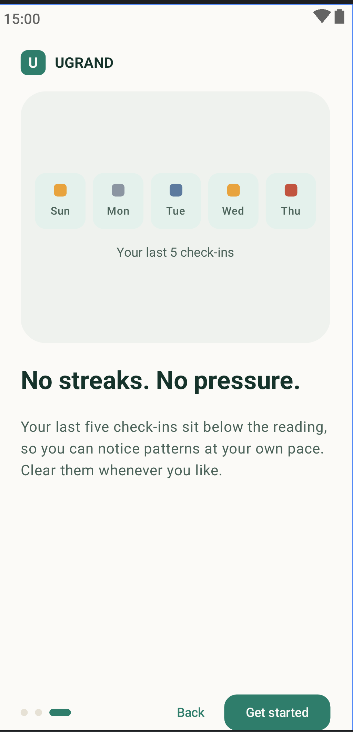
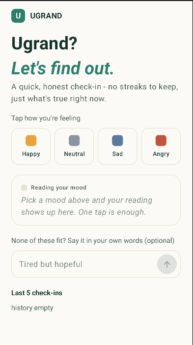
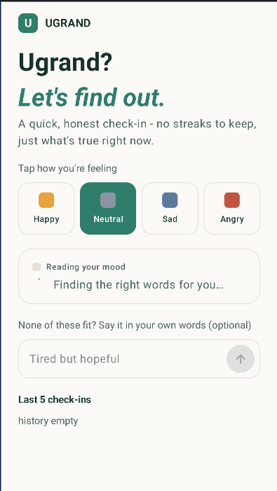
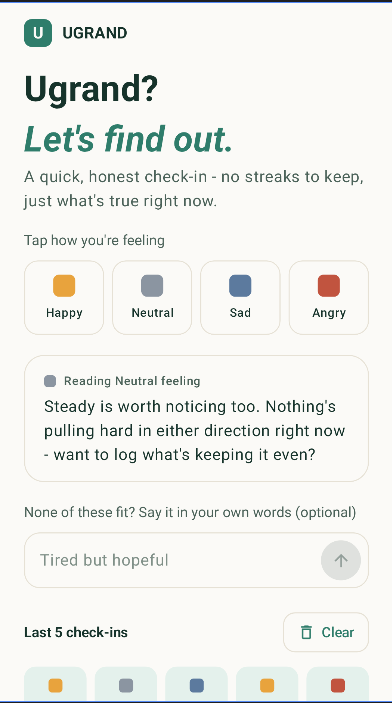

# Ugrand❓(Formerly MoodTracker) 🙂

Ugrand? (formerly MoodTracker) is a Jetpack Compose Android app for quick, honest mood check-ins. Tap how you feel (or type it in your own words) and get a short, AI-generated reflection straight away. Built as a demonstration of production-grade Android architecture.
---
## 📱 Screenshots
### Screen

## ✨ Features

- One-tap check-in: tapping a mood immediately generates a reading. There is no separate "log" button.
- Change your mind: tapping a different mood cancels the in-flight request, and only the mood you settle on is saved to history.
- Say it in your own words: an optional text field (140 characters max) lets you describe a feeling that none of the four moods fit. It gets its own AI-generated response and is saved as a custom entry.
- AI-powered readings via the Gemini API, personalized using your recent mood history.
- Reading card with three states: an empty hint, a loading indicator, and the message, all in one stable card.
- Offline / fallback messages: a local supportive message is shown when the AI call fails.
- History: the last five check-ins shown as colour-coded chips (day, colour, mood label), stored locally with Room and updated live. History can be cleared at any time.
- First-run onboarding: a three-page pager (Welcome, Tap a mood, No streaks) with Back, Next, Skip and Get started controls. It is shown once, and the choice is remembered with DataStore.
- Splash screen: held until the onboarding flag has been read, so returning users never see a flash of onboarding.
- Splash screen: held until the onboarding flag has been read, so returning users never see a flash of onboarding.

## 🔍 Architecture

presentation/   → Compose UI + ViewModels (Hilt-injected)
domain/         → Models, repository contracts, and use cases (no Android/Room/network dependencies)
data/           → Repository implementations, Room DAO/entities, DataStore, Gemini network client, mappers

## 🎯 Key architectural decisions:

Repository pattern: domain defines the contracts (MoodRepository, AiPromptRepository, OnboardingRepository) and data provides the implementations. The rest of the app depends only on the contracts.
Use cases own business logic that spans repositories or encodes app-specific rules:
LogMoodUseCase assigns the timestamp when a mood is logged.
GetJournalingPromptUseCase fetches recent mood history before requesting an AI prompt.
HasCompletedOnboardingUseCase and CompleteOnboardingUseCase read and write the onboarding flag.
Mappers convert between Room entities and domain models at the repository boundary. No persistence-layer types ever reach the ViewModel or UI.
Stateless composables for previews: screens are split into a thin stateful wrapper (which talks to the ViewModel) and a stateless content composable that takes plain state and callbacks, so every piece can be previewed without Hilt.
Cancellable requests: LogMoodViewModel keeps a reference to the running request Job. A new tap cancels the previous request, and the mood is logged only after its message arrives, so abandoned taps never reach history.
Dependency injection via Hilt: repositories, use cases, DataStore and the database are all provided through Hilt modules. ViewModels are injected with @HiltViewModel.

## 💾 Data storage
Data	Storage	Notes
Mood history	Room (mood_entries table)	Stores the mood, an optional customText, and a timestamp
Onboarding completed flag	Preferences DataStore	A single boolean, read once at startup

## 🛠️ Tech Stack
- Kotlin
- Jetpack Compose (Material 3) with HorizontalPager for onboarding
- Clean Architecture (data / domain / presentation separation)
- MVVM with unidirectional state via StateFlow
- Hilt for dependency injection
- Room for local persistence
- Preferences DataStore for app settings
- AndroidX SplashScreen API
- Kotlin Coroutines & Flow
- Gemini API for AI-generated readings
- Gradle Kotlin DSL
- Min SDK 26

Mood entries are stored locally on the device. The app does not use accounts, analytics, or cloud storage. Mood labels are sent to the Gemini API only to generate a journaling prompt; no other personal data leaves the device.

## ⚖️ License

This project was created by Odwa Mtatambi.